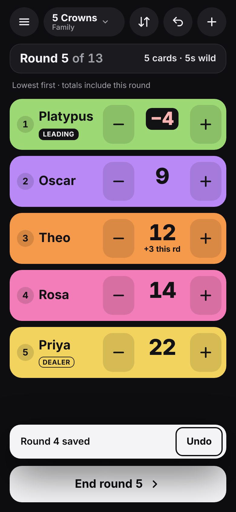

# Score Counter

A free, ad-free score counter for card and board games. It works offline, installs to your iPhone or iPad Home Screen, and keeps everything on your device.

**Live:** https://i-higgins.github.io/score-counter/



## What it does
- **Always shows grand totals.** Tap + and − during a round to build each player's "this round" amount under their total. **End round** opens a keypad to check each score, then saves the round.
- **Sorts itself** (lowest first, highest first or manual). It waits a moment after your last tap and never moves a row while your finger is on the screen. Tied players share a rank (1, 1, 3).
- **Built-in games:** 5 Crowns, Dutch Blitz, Phase 10, Skip-Bo, Uno, 500, President (Scum) and Fishbowl, each set up with its usual scoring. Change any of them in Games.
- **How to play:** the ⓘ button next to a game (and **How to play** in the in-game menu) shows a short guide to getting started and scoring, your own notes, and a link to the full rules on Wikipedia. The guide works offline; the link needs the internet and opens in your browser.
- **Notes:** add house rules or reminders to any game, built-in or your own. They're shown in How to play and travel with shared games.
- **Phase tracker** (Phase 10): tick who made their phase when you save each hand. Players are ranked by phases finished, then points, and the game ends after someone finishes the last phase.
- **Your own games:** high or low wins, end at a target, after the last round or never, round range, round labels (numbers, cards and wild card, or your own names like Fishbowl's), quick buttons, phase tracker, and dealer or first-player marker. You can create, edit, duplicate, hide from New game, and delete them. **Finish game** in the menu ends any game, including ones that never end by themselves.
- **Teams:** for team games (500, Fishbowl), add each team as a player.
- **Groups and stats:** groups you make (like Family) keep every finished game. Stats show wins, win %, average and best, for all games or one game. Ties are shared wins. Quick games aren't counted.
- **History:** a round-by-round table for every game. Tap a round number to fix a score.
- **Sharing:** share a game's *rules* as a link or a file. Opening one always asks before adding it.
- **Never loses your place:** everything saves as you tap. Closing the app, even halfway through entering a round, brings you back exactly where you were. Undo still works after relaunching.
- Negative totals are highlighted, rows go compact at 6+ players, the screen stays on during a game, and you can back up and restore everything.

## Installing on iPhone or iPad
1. Open **https://i-higgins.github.io/score-counter/** in **Safari**.
2. Tap **Share**, then **Add to Home Screen**.
3. Open it **once from the Home Screen icon while online**. It saves itself for offline use.
4. From then on it works with no internet, even in aeroplane mode. Always use the Home Screen icon: **Home Screen apps keep their own data, separate from Safari tabs**, so games played in a Safari tab won't appear in the installed app (back up in the tab and restore in the app if you need to move them).

## Backing up
Everything is stored on the device only. Deleting the app or clearing Safari's website data deletes it too, and there's no account to get it back from. Use **Settings → Back up to a file** now and then and keep the file somewhere safe, like iCloud Drive. **Restore** adds the backup's groups, games and history back, and restoring twice never duplicates anything.

## Sharing a game
In a game's settings, tap **Share**. The link looks like `…/score-counter/#game=…`. The rules are encoded after the `#`, which browsers never send to a server. The link holds only the rules and notes: no players, scores or history. Opening it on another phone (with the app installed once) shows the rules and asks before adding. A game with the same name is added alongside, never replaced.

## Guided Access tip
If a child is keeping score and might leave the app by accident, turn on **Settings → Accessibility → Guided Access**, open Score Counter, then triple-click the side (or Home) button.

## Privacy
Nothing leaves the device. There's no server, account, analytics, tracking, ads or in-app purchases, and the Content-Security-Policy blocks requests to other sites. The only web addresses in the app are the Wikipedia "Full rules" links, which open in your browser only when you tap them.

## Accessibility
Aims for WCAG 2.2 AA. It has Dark (the default), Light and High contrast themes, three text sizes, 44 px or larger touch targets, screen-reader labels and reduced motion. Pinch zoom is off on purpose, because accidental zooms mid-game are confusing; the Text size setting replaces it.

## Running it locally
```sh
npm install
npx playwright install chromium webkit
npm start                 # http://localhost:8080
npm test                  # unit tests (game logic, sharing, stats, offline precache, rules)
npm run test:e2e          # Chromium + WebKit: full games, resume, sharing, offline, backup, accessibility
npm run screenshots       # every screen × iPhone/iPad × portrait/landscape × theme, into screenshots/
```

| Command | What it does |
| --- | --- |
| `npm start` | Serve locally (`BASE=/score-counter/ npm start` to test the Pages subpath) |
| `npm run precache` | Update the service worker's file list after adding or removing files |
| `npm run icons` | Make the icon PNGs from `assets/app/*.svg` |

**Releasing:** bump `APP_VERSION` in `js/config.js` and `VERSION` in `sw.js` together (a test checks), or installed devices keep the old version.

## How it's built
Vanilla HTML, CSS and JavaScript (ES modules). There's no framework, build step or runtime dependencies. It started from [offline-app-template](https://github.com/I-Higgins/offline-app-template); the design is in `design/` (a Claude Design export, reference only). Game logic is in `js/model.js` and is unit-tested. Data is in IndexedDB via `js/data.js`.

## Licence
MIT. Free for anyone to use.
